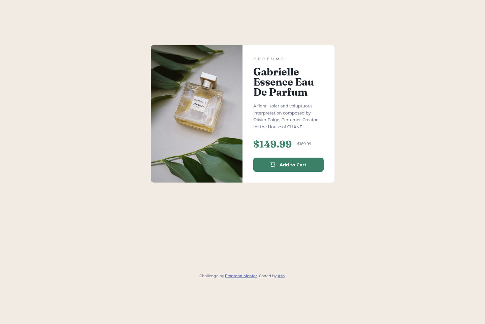

# Frontend Mentor - Product preview card component solution

This is a solution to the [Product preview card component challenge on Frontend Mentor](https://www.frontendmentor.io/challenges/product-preview-card-component-GO7UmttRfa). Frontend Mentor challenges help you improve your coding skills by building realistic projects. 

## Table of contents

- [Overview](#overview)
  - [The challenge](#the-challenge)
  - [Screenshot](#screenshot)
  - [Links](#links)
- [My process](#my-process)
  - [Built with](#built-with)
  - [What I learned](#what-i-learned)
  - [Continued development](#continued-development)
  - [Useful resources](#useful-resources)
- [Author](#author)
- [Acknowledgments](#acknowledgments)

## Overview

### The challenge

Users should be able to:

- View the optimal layout depending on their device's screen size
- See hover and focus states for interactive elements

### Screenshot

## My process

### Built with

- Semantic HTML5 markup
- CSS custom properties
- Flexbox
- CSS Grid
- Mobile-first workflow

### What I learned

Full disclosure: After I attempted to do the challenge myself I did watch [Kevin Powell's video](https://www.youtube.com/watch?v=B2WL6KkqhLQ) on how he did the challenge. My goal was not to copy but to see what it was I may have done wrong, or what I could have improved as I have never known if I implemented a mobile-first design correctly. I only reworked sections that needed to be cleaned up, like the resets and if I over-implemented code (such as extra uses of `color`). From the video I did learn how to not overcomplicate my CSS by using `grid` in places where I need to center things instead of using `flexbox`.

It's also thanks to that video that I got to learn how to properly implement `<picture>` as I didn't quite understood it at first when I looked at MDN's docs on it.

I also got to experiement with `line-height`, something I've never touched much before in my years of knowing CSS as I've always been afraid to make things too spacious or too cramped between lines. Having a design to work with gave me confidence on how I can use it next time if need be.

### Continued development

Thanks to this project I have more confidence on implementing a mobile-first design, something I would overcomplicate originally.

### Useful resources

- As stated before, [Kevin Powell's video](https://www.youtube.com/watch?v=B2WL6KkqhLQ) on the challenge. He does a great job explaining his thought process from how to write the HTML, then tackling the CSS, and explaining his methodologies.
- [MDN](https://developer.mozilla.org/en-US/) has always been a great resource for documentation on not just CSS, but HTML and JavaScript as well. For this project I referenced how to implement the `<picture>` element, even though I had to watch the aforementioned video to fully comprehend it. It did give me a starting point if anything.

## Author

- Website - [Ash Chapman](https://boundothewitch.github.io/)
- Frontend Mentor - [@BoundoTheWitch](https://www.frontendmentor.io/profile/BoundoTheWitch)

## Acknowledgments

Once again, I'd like to thank [Kevin Powell](https://www.youtube.com/@KevinPowell) on his not just the one video I've referenced, but all of his videos on front-end development. He has a great selection of tutorials and tips-and-tricks that's great for both newcomers and veterans. He even does videos showcasing various new HTML and CSS features that are upcoming, or are already implemented in browsers.